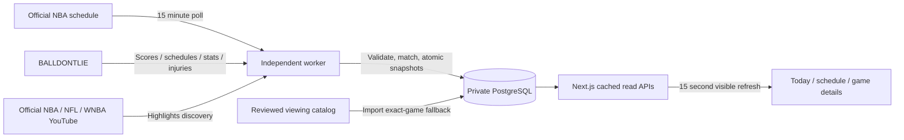

# Warriors viewing networks

## Data flow

The independent worker checks the public [NBA league schedule](https://cdn.nba.com/static/json/staticData/scheduleLeagueV2.json) every 15 minutes. This is the structured schedule behind the [official Warriors schedule](https://www.nba.com/warriors/schedule). It requires no additional subscription or key. It is a public website feed with no guaranteed schema, availability or update SLA.

The adapter reads U.S. national TV/OTT and the Warriors' own home/away regional TV/OTT. Opponent-only local TV, radio and non-U.S. regional listings are excluded. Access depends on the viewer's location and subscription; a network listing does not promise free or universal streaming access.

NBA game IDs and BALLDONTLIE IDs are different. Match only one stored game with the same home/away abbreviations and exact UTC start time. The database retains both IDs. A changed matchup, ambiguous match, removed game or postponed listing cannot silently keep an old network assignment. Feed links must pass the existing official-host HTTPS allowlist; otherwise use the NBA's game-specific watch redirect.



## Freshness and failure behavior

- Migration `009_official_broadcasts.sql` adds `official_broadcasts` and `broadcast_sync_state`. A persisted reservation prevents immediate repolling after worker restarts. The existing worker advisory lock prevents duplicate schedulers.
- Successful checks publish the full validated snapshot in one transaction. A valid empty network list clears previous networks. Removed/moved games expire their previous snapshots.
- Fetch timeout: 20 seconds. Decoded body limit: 16 MiB. Redirects are rejected. Requests go only to the fixed official URL; HTTP 403 responses trigger normal backoff, with no proxy or challenge bypass.
- Failed checks retain the previous snapshot and show a delayed-update notice. Retries back off from 15 minutes to 6 hours; HTTP 429 honors bounded Retry-After values up to 24 hours. After 24 hours, cached automatic network links disappear and the official schedule remains available. An expired automatic entry never revives an older manual listing.
- A newer explicit manual correction can override an older automatic listing. Manual timestamps are never advanced just because the catalog is reimported. NFL/WNBA viewing options remain reviewed catalog entries.
- The caption distinguishes `Checked` automatic listings from `Reviewed` manual listings. Highlight timestamps do not change broadcast freshness. Existing score and highlights spoiler protection remains intact.
- Browser refreshes use stored API data. No client request polls NBA directly or consumes BALLDONTLIE/YouTube quota. This adds no new AWS service or paid data subscription.

## Release and recovery

Activated and verified on October 26, 2026. From the owner's normal PowerShell session:

```powershell
node "C:\Users\abhin\Documents\Codex\2026-10-20\if-x20\outputs\bayline-mvp\deploy\aws\publish-broadcasts.mjs"
```

The helper checks the existing AWS identity and a clean committed tree, builds prebuilt web/worker images in CodeBuild, takes a verified off-server backup, applies additive migration 009, imports the reviewed correction, and starts both images. It verifies the broadcast task, public APIs, existing advanced details, readiness and a fresh isolated restore containing all nine migrations and broadcast state. PostgreSQL is not restarted or exposed publicly. Source/images/configuration are archived privately for recovery.

If the upstream feed is unavailable from production, the release retains the reviewed correction and records the automatic task's error/backoff. The delayed notice remains visible. A successful automatic source check must be observed before claiming that live syncing has been verified.

Evidence is written to ignored `deploy/evidence/broadcasts-release.json`. Rollback restores previous image/configuration references and leaves additive tables in place. On server loss, follow `deploy/RUNBOOK.md`, using the matching release archive and an off-server backup. Restoring the database also restores broadcast snapshots and retry timing; the worker resumes when the saved gate becomes due. Provider secrets must be reinstalled through their existing secret mounts.

On October 26, 2026 the official schedule listed Warriors at Nuggets (NBA `0022600127`, BALLDONTLIE `21717970`) at 7 p.m. Pacific with Peacock and NBC Sports Network. That exact reviewed fallback ships in the catalog; later successful source checks can correct or remove it.

Production verification: release `38a1e7226fa2ffefbb5410612d66129a9a07c868` is live with 18 official broadcast snapshots. A worker refresh succeeded at 6:38 p.m. Pacific and scheduled its next check for 6:53 p.m. Public readiness is healthy. The verified off-server backup restored all nine migrations, 47 games and all 18 broadcast snapshots into a separate database. Evidence is retained in ignored `deploy/evidence/broadcasts-release.json` and `deploy/evidence/broadcasts-refresh.json`.
